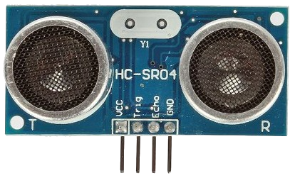

In this activity, you will implement a circuit that contains an ultrasonic distance sensor. After calibrating the sensor, you will use it to detect items at various distances and subsequently sort the item distances using one of the three sorting algorithms that you have learned so far (i.e., bubble sort, selection sort, and insertion sort). You will need the following items:

- Raspberry Pi with power adapter

- LCD touchscreen

- Keyboard and mouse

- Breadboard

- GPIO-to-breadboard interface board with ribbon cable

- Jumper wires provided in your kit

- 1K Ohm and 2K Ohm resistors (provided to you during the activity)

- HC-SR04 ultrasonic ranging module (provided to you during the activity)

## Connecting the Breadboard

Since this activity makes use of an external circuit, you will need to connect the RPi to the breadboard through the GPIO interface board. If necessary, refer to the *LED the Way* activity for details on how to connect the RPi to the breadboard, and for wiring of power and ground across the top and bottom rails of the breadboard.

::: {.callout-warning}
## Caution!
Make sure that the ribbon cable is not connected backwards!
:::

## Measuring an Object's Distance

Although there are many different ways that the distance to an object can be measured, this activity makes use of an ultrasonic range module (specifically, the HC-SR04). This "sensor" provides accurate distance measurements from 2cm to 400cm. It includes a transmitter (basically, speakers), a receiver, and control circuitry, so it can easily interface with the RPi!

{width=50%}

The HC-SR04 has four pins:

- **VCC**: power (requires 5V)

- **GND**: ground

- **TRIG**: trigger (sends an ultrasonic pulse)

- **ECHO**: echo (transmits the duration of the ultrasonic pulse)

## How the Sensor Works

The transmitters emit a high frequency ultrasonic sound (i.e., sound waves that are typically greater than 20 kHz, which is higher than humans can hear) that bounces (i.e., is reflected) off of any solid object. The idea is that some of the ultrasonic sound bounces off of the solid object, is subsequently detected by the receiver on the sensor, and finally processed by the control circuitry to calculate the time difference between sending and receiving the reflected ultrasonic sound. With a few final calculations (on the RPi), the distance between the sensor and the object can be calculated.

Specifically, the RPi will be used to send an output signal (i.e., set a GPIO output pin high) to the sensor's **TRIG** pin. This will trigger the sensor to send an ultrasonic pulse. This pulse will bounce off of the desired object, allowing the sensor to detect some of the reflected ultrasonic sound waves. The sensor then calculates the time that it took for the pulse to travel from its transmitters to the object and back to its receiver. It then sets its **ECHO** pin high for the duration that it calculated. Since the sensor's **ECHO** pin is connected to a GPIO input pin, the RPi can detect the duration.

The RPi must then measure how long the GPIO input pin connected to the sensor's **ECHO** pin is set to high by the sensor. As noted, this duration represents how long it took for the sensor's pulse to leave its transmitters, get reflected off of the object, and return back to its receiver. The distance from the sensor to the object can then be calculated.
