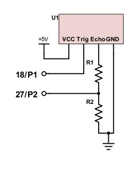
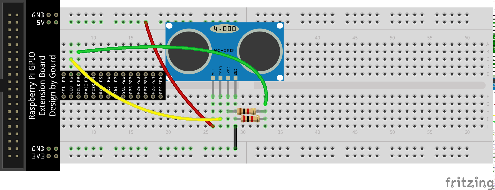
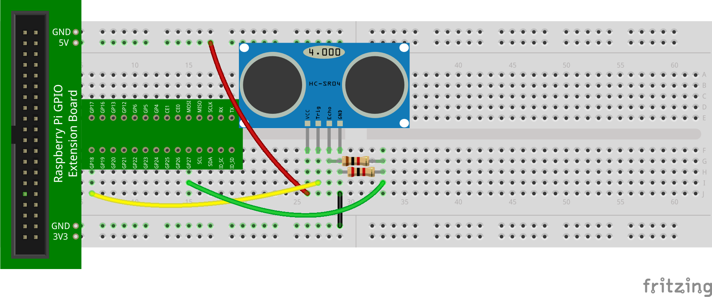
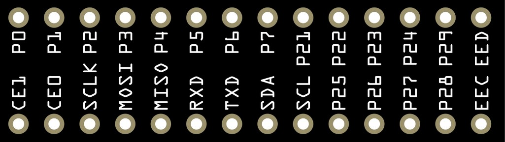
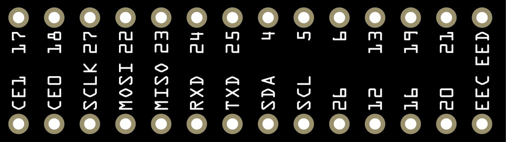

The main goal is to connect the sensor's **VCC** pin to the RPi's 5V source, **GND** to the RPi's ground, **TRIG** to a GPIO output pin (although we'll do so in a different way), and **ECHO** to a GPIO input pin. First, implement the following circuit:

{width=40%}

Here's one way to layout the circuit if you have the green GPIO interface board:

::: {.callout-note}
Note the use of the two resistors! The sensor's **ECHO** pin is not directly connected to a GPIO pin on the RPi. This is explained in the next section.
:::

We'll use GP18 for the sensor's **TRIG** pin and GP27 for the sensor's **ECHO** pin. If you have the black GPIO interface board, layout the circuit as follows instead:

## GPIO Pin Numbering

Recall that GP18 (on the green GPIO interface board) matches with P1 (on the black GPIO interface board). Similarly, GP27 matches with P2. This was discussed earlier and made reference to the following table:

| BCM | wPi | Name    | Physical | Physical | Name    | wPi | BCM |
|----:|----:|--------:|:--------:|:--------:|---------|-----|-----|
|     |     | 3V3     | 1        | 2        | 5V      |     |     |
| 2   | 8   | SDA.1   | 3        | 4        | 5V      |     |     |
| 3   | 9   | SCL.1   | 5        | 6        | GND     |     |     |
| 4   | 7   | GPIO.7  | 7        | 8        | TXD     | 15  | 14  |
|     |     | GND     | 9        | 10       | RXD     | 16  | 15  |
| 17  | 0   | GPIO.0  | 11       | 12       | GPIO.1  | 1   | 18  |
| 27  | 2   | GPIO.2  | 13       | 14       | GND     |     |     |
| 22  | 3   | GPIO.3  | 15       | 16       | GPIO.4  | 4   | 23  |
|     |     | 3V3     | 17       | 18       | GPIO.5  | 5   | 24  |
| 10  | 12  | MOSI    | 19       | 20       | GND     |     |     |
| 9   | 13  | MISO    | 21       | 22       | GPIO.6  | 6   | 25  |
| 11  | 14  | SCLK    | 23       | 24       | CE0     | 10  | 8   |
|     |     | GND     | 25       | 26       | CE1     | 11  | 7   |
| 0   | 30  | SDA.0   | 27       | 28       | SCL.0   | 31  | 1   |
| 5   | 21  | GPIO.21 | 29       | 30       | GND     |     |     |
| 6   | 22  | GPIO.22 | 31       | 32       | GPIO.26 | 26  | 12  |
| 13  | 23  | GPIO.23 | 33       | 34       | GND     |     |     |
| 19  | 24  | GPIO.24 | 35       | 36       | GPIO.27 | 27  | 16  |
| 26  | 25  | GPIO.25 | 37       | 38       | GPIO.28 | 28  | 20  |
|     |     | GND     | 39       | 40       | GPIO.29 | 29  | 21  |

The following simpler cross-reference was also included. It provided a conversion from the pin layout on the black GPIO interface board (on the left) that implements the wiringPi pin layout to the BCM pin layout that the green GPIO interface board uses (on the right):

Therefore, if the **TRIG** pin on the sensor is connected to GP18 on the green GPIO interface board, then it would be connected to P1 on the black GPIO interface board.

## Positioning

To properly measure the distance between the sensor and various objects, make sure to orient the sensor so that its transmitters are pointing toward the objects. This may change the orientation of the pins when compared to the layout diagrams above. Make sure that the sensor's pins are properly connected as specified. Also, the breadboard will need to be relatively flat so that the sensor level is resulting in ultrasonic pulses that are sent directly toward the objects.
