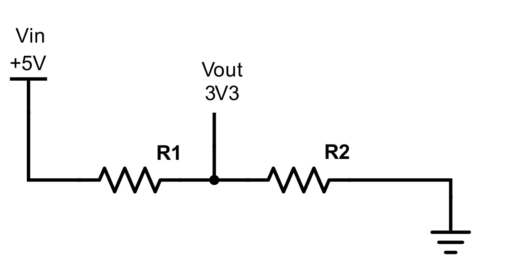

You may have noticed that the sensor's **ECHO** pin is actually connected to a 1K Ohm (brown, black, red) resistor. This resistor is connected to both GP27 and to a 2K Ohm (red, black, red) resistor. The second resistor is then connected to GND. This circuit configuration is called a **voltage divider**.

The RPi's input pins can handle 0V to 3.3V. Anything greater than 3.3V could potentially damage the RPi! The HC-SR04 sensor's **ECHO** pin produces 5V when set high because its VCC pin is connected to the RPi's 5V supply. This voltage is too high and must therefore be reduced to 3.3V when connected to an input pin on the RPi. We can use two resistors in series to effectively reduce the voltage. In general, a voltage divider circuit is configured as follows:

{width=60%}

## Deriving the Output Voltage

To see how this circuit works, we need to determine the output voltage, $V_{out}$, in terms of the input voltage, $V_{in}$ (the voltage we start with). Let's consider +5V in the diagram above as $V_{in}$. There are two resistors in series between $V_{in}$ and ground. First, we use Ohm's Law to find the current flowing through the entire circuit:

$$
\begin{aligned}
V &= IR \\
V_{in} &= I(R_1 + R_2) \\
I &= \frac{V_{in}}{R_1 + R_2}
\end{aligned}
$$

Now that we know the current flowing through the entire circuit (in general terms), we can calculate the output voltage, $V_{out}$, based on this (note that only $R_2$ exists from $V_{out}$ to ground):

$$
\begin{aligned}
V &= IR \\
V_{out} &= IR_2 \\
V_{out} &= V_{in} \frac{R_2}{R_1 + R_2}
\end{aligned}
$$

## Choosing the Resistors

To properly reduce the voltage, the resistor values required in the circuit must be calculated. The easiest way to do this is to set one of the resistors to a known value and calculate the other. We can therefore solve for $R_2$ as follows:

$$
\begin{aligned}
V_{out} &= V_{in} \frac{R_2}{R_1 + R_2} \\
\frac{V_{out}}{V_{in}} &= \frac{R_2}{R_1 + R_2} \\
V_{out}(R_1 + R_2) &= V_{in} R_2 \\
V_{out} R_1 + V_{out} R_2 &= V_{in} R_2 \\
V_{in} R_2 - V_{out} R_2 &= V_{out} R_1 \\
R_2 (V_{in} - V_{out}) &= V_{out} R_1 \\
R_2 &= \frac{V_{out} R_1}{V_{in} - V_{out}}
\end{aligned}
$$

Let's set $R_1$ to 1K Ohm. We now have the following: $V_{in}$ is +5V, the desired $V_{out}$ is +3.3V, and $R_1$ is 1K Ohm. We can calculate the value of $R_2$:

$$
\begin{aligned}
R_2 &= \frac{3.3\text{ V}\,(1000\text{ Ohms})}{5\text{ V} - 3.3\text{ V}} \\
R_2 &= \frac{3300\text{ V Ohms}}{1.7\text{ V}} \\
R_2 &= 1941.18\text{ Ohms}
\end{aligned}
$$

Therefore, a 2K Ohm resistor for $R_2$ should work just fine! In the layout diagrams, you can see that the sensor's **ECHO** pin is connected to the 1K Ohm and 2K Ohm resistors in series to GND. The RPi's GPIO input pin is connected in between the two resistors, where the voltage ($V_{out}$) has been appropriately reduced from 5V to 3.3V.

You may wonder why we don't simply connect the sensor's VCC pin directly to 3.3V, thereby ensuring that its **ECHO** pin will also produce 3.3V. Unfortunately, the sensor is not stable at 3.3V. It requires 5V to sense properly.
